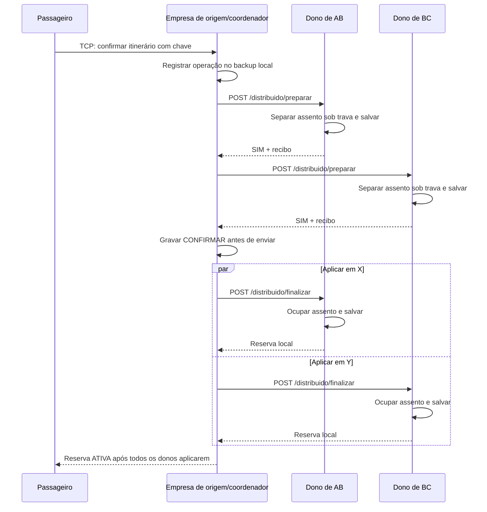

# API REST e protocolo 2PC

Cada empresa mantém suas contas, ofertas e assentos em memória e em um arquivo local privado. As empresas se comunicam por HTTP/JSON; os clientes continuam usando sockets TCP nativos com NDJSON. Não há servidor central, banco compartilhado ou serviço externo de coordenação.

## Coordenador por transação

A empresa que recebe a reserva é o coordenador daquela transação. Uma reserva iniciada na VaiJunto é coordenada pela VaiJunto; outra iniciada na Minas é coordenada pela Minas. Não existe coordenador fixo para todo o consórcio.

A implementação usa **Commit em Duas Fases (2PC) com relógio de Lamport**, sem eleição nem decisão por votação. A terceira empresa não participa da decisão quando não é origem nem dona de um trecho envolvido.

1. **Preparar:** o coordenador pede a cada dono que separe seus assentos. O dono verifica e altera as vagas sob trava e salva a preparação antes de responder SIM.
2. **Decidir:** se todos responderem SIM, o coordenador grava CONFIRMAR no seu backup. Se houver recusa ou falha antes da decisão, grava ABORTAR. Só depois envia o resultado aos donos.

A decisão registrada é imutável. Respostas perdidas são tratadas repetindo a mesma operação, sem ocupar ou devolver o mesmo assento novamente. A origem só apresenta a reserva como ATIVA após receber a confirmação de aplicação de todos os donos.

## Recursos e autenticação

Todas as rotas exigem `Authorization: Bearer TOKEN`, com o mesmo token de pelo menos 16 bytes em cada empresa. Recibos e decisões usam HMAC-SHA256 com essa chave compartilhada. O modelo considera falhas por interrupção e perda de comunicação; não empresas maliciosas com acesso ao token. HTTP não cifra o tráfego e a porta publicada precisa estar acessível na rede.

| Método | Caminho | Responsabilidade |
|---|---|---|
| GET | `/saude` | Identidade e estado básico do catálogo |
| GET | `/trechos` | Somente ofertas locais disponíveis, sem contas ou dados pessoais |
| GET | `/consorcio/trechos` | Consulta paralela aos catálogos locais dos pares |
| GET | `/distribuido/saude` | Identidade e geração do histórico local |
| POST | `/distribuido/preparar` | Fase 1: separar vagas locais ou validar um cancelamento |
| POST | `/distribuido/finalizar` | Fase 2: aplicar a decisão autenticada |
| GET | `/distribuido/estado?id=ID` | Consultar a decisão no coordenador da transação |
| POST | `/distribuido/cancelar` | Encaminhar ao coordenador original o cancelamento solicitado em outro dono |

As chamadas entre empresas usam somente API REST própria, implementada com a biblioteca padrão de Go. Os nomes internos `prepararRPC` e `resultadoRPC` são estruturas JSON, sem framework de RPC.

## Relógio de Lamport

Cada servidor mantém um contador lógico sob mutex. Um evento local ou envio incrementa `L`; uma recepção calcula `L = max(L, recebido) + 1`. Todas as chamadas e respostas de coordenação usam o cabeçalho obrigatório `X-Lamport`, inclusive as consultas de saúde e estado. Chamadas à própria empresa seguem as mesmas regras em memória. O contador é persistido antes dos envios e das respostas de sucesso e restaurado com o backup. Uma recepção de resposta também é persistida.

Exemplo: VaiJunto envia com `L=8`; Minas estava em `L=20`, recebe e avança para `21`; ao responder avança para `22`; VaiJunto recebe e avança para `23`. Nenhum passo consulta a hora física. A transação registra sua marca inicial em `meta.lamport`; preparações registram a marca lógica local em `ordem_local`. A recuperação percorre operações por `(lamport, empresa_origem, transacao_id)`, usando os IDs como desempate determinístico.

Lamport representa causalidade, não uma fila global de reservas: uma mensagem atrasada com número menor não desfaz uma preparação já aceita. A vaga continua protegida pelo dono, e a primeira preparação admitida sob trava vence a disputa local. O 2PC exige todos os donos para confirmar. Horários de partida continuam sendo instantes RFC3339; timeouts e intervalos de recuperação são durações locais, pois um contador lógico não detecta silêncio de rede.

Para uma consulta manual de diagnóstico, envie também `-H 'X-Lamport: 1'`. Esse valor é apenas um evento de um cliente de diagnóstico, não o contador de outra empresa. As rotas de catálogo (`/trechos`, `/consorcio/trechos`) não executam coordenação 2PC e não exigem esse cabeçalho.

## Catálogo

`GET /trechos` devolve:

```json
{
  "empresa_id": "minas",
  "trechos": [
    {
      "empresa_id": "minas",
      "trecho_id": "T000001",
      "carona_id": "C000001",
      "origem": "A",
      "destino": "B",
      "data_hora": "2099-10-01T08:00:00-03:00",
      "assentos_livres": 1,
      "capacidade": 1,
      "preco": 20,
      "distancia_km": 10,
      "tempo_viagem_min": 30,
      "tempo_parada_min": 0
    }
  ]
}
```

A consulta agregada devolve `trechos` e `empresas_indisponiveis`. Consulta somente `/trechos` dos pares, evitando chamadas recursivas. Uma falha não elimina as ofertas das empresas que responderam. A resposta de catálogo é limitada a 8 MiB. A disponibilidade consultada não reserva vagas; a preparação deve verificá-las novamente.

## Fase 1: preparação

O corpo tem dois campos: `meta`, com a identificação da transação, e `pedido`, com os trechos do destinatário.

```json
{
  "meta": {
    "lamport": 8,
    "transacao_id": "identificador-global",
    "empresa_origem": "vaijunto",
    "inicio_itinerario": "2099-10-01T08:00:00-03:00",
    "tipo": "RESERVAR",
    "participantes": ["minas", "vaijunto"],
    "hashes": {"minas": "resumo-do-pedido", "vaijunto": "resumo-do-pedido"},
    "geracoes": {"minas": "geracao-minas", "vaijunto": "geracao-vaijunto"}
  },
  "pedido": {
    "transacao_id": "identificador-global",
    "empresa_origem": "vaijunto",
    "inicio_itinerario": "2099-10-01T08:00:00-03:00",
    "passageiro_ref": "referencia-autenticada",
    "participantes": ["minas", "vaijunto"],
    "trechos_ids": ["T000001"]
  }
}
```

Os resumos e as gerações são ilustrativos. O pedido real é construído pelo servidor e validado pelo dono. Uma resposta SIM contém `recibo`; a preparação é persistida antes de responder. Um conflito retorna erro e o coordenador decide ABORTAR. Uma transação já finalizada não é reaberta por preparação atrasada.

A geração é uma identidade aleatória do histórico local, preservada no backup. Não é relógio. Se perder o arquivo e iniciar vazio, o servidor não pode aplicar mensagens de uma geração antiga como se ainda possuísse os dados.

## Fase 2: decisão e aplicação

`POST /distribuido/finalizar` recebe `meta`, `valor` e `assinatura`. `valor` contém `estado` (CONFIRMAR ou ABORTAR), motivo opcional e os recibos das preparações. CONFIRMAR exige recibos de todos os donos. A assinatura HMAC vincula os metadados e o valor.

O receptor verifica a identidade da operação, sua geração, a autenticação e a ausência de decisão conflitante. A confirmação converte assentos preparados em ocupados, sem novo desconto. O aborto devolve somente assentos separados por essa transação. A aplicação repetida retorna o estado existente, sem duplicar efeitos. A aplicação é salva antes da resposta HTTP.

## Sequência da confirmação



Se um dono recusar, o coordenador grava ABORTAR e transmite essa decisão, incluindo aos donos que já prepararam. Se a resposta não chegar a um dono, a entrega será repetida.

## Exclusão mútua, precedência e deadlock

Cada dono protege seus próprios trechos com mutexes adquiridos em ordem de ID. A escolha do assento e a marcação como preparado ocorrem na região protegida. Outra transação não pode usar assento ocupado ou preparado.

O desempate sobre a última vaga é a primeira preparação admitida na seção crítica do dono. Não depende de horário de envio ou de relógio físico de outro servidor. Os participantes são preparados em ordem de identificador e um conflito é recusado sem esperar a vaga de outra transação. Isso evita espera circular de recursos, mas pode aumentar recusas e novas tentativas.

## Falhas e recuperação

| Falha | Comportamento |
|---|---|
| Dono indisponível antes da preparação | Não confirma a viagem que depende dele; outras operações continuam |
| Recusa ou timeout durante a fase 1 | Coordenador registra ABORTAR; repete a liberação nos donos que responderem |
| Coordenador cai sem decisão registrada | Participantes mantêm assentos preparados; quando o coordenador volta com seu backup, registra ABORTAR |
| Coordenador cai após gravar CONFIRMAR | Ao voltar, reenvia CONFIRMAR; nunca troca por ABORTAR |
| Participante cai depois de responder SIM | Restaura sua preparação e consulta o coordenador |
| Resposta da fase 2 se perde | Reenvio idempotente da mesma decisão |
| Backup não pode ser gravado | Não responde SIM nem transmite decisão final sem a gravação exigida |

**Limitação do 2PC:** um participante preparado pode ficar bloqueado esperando o coordenador voltar. Ele nunca aborta sozinho por timeout. Outras empresas e recursos sem relação continuam operando; uma reserva inteiramente local usa seu fluxo local.

`GET /distribuido/estado?id=ID` devolve `decisao` quando o coordenador possui resultado. Sem resultado, devolve objeto vazio; isso não autoriza o participante a liberar vagas. A consulta só devolve uma decisão depois de salvar o backup local. Um participante não assume o papel de coordenador para escolher outro resultado.

A recuperação é consultada periodicamente. O coordenador observa registros sem decisão durante um intervalo de suspeita de 10 segundos, medido por tempo monotônico local a partir da primeira observação; datas físicas salvas no backup não determinam esse intervalo. Esse prazo não é uma garantia de conclusão. Uma chamada ativa da mesma reserva é aguardada antes da recuperação. A decisão persistida sempre prevalece. Relógios físicos corretos continuam necessários para regras de partida, cancelamento e expiração de sessão; a coordenação causal e a segurança do assento não comparam horários de cliques entre computadores.

## Cancelamento distribuído

O cancelamento também usa preparação e decisão 2PC, coordenadas pela empresa de origem da reserva. Um motorista em outra empresa encaminha a solicitação a ela. Os donos verificam se a reserva existe e se o itinerário ainda não começou. Somente uma decisão de cancelamento confirmada autoriza devolver as vagas. A origem registra o cancelamento e a notificação. Se o coordenador estiver indisponível, o cancelamento aguarda nova tentativa; não desfaz unilateralmente só um trecho.

## Códigos HTTP

| Código | Significado |
|---|---|
| 200 | Consulta ou operação processada; observar o conteúdo retornado |
| 400 | Cabeçalho `X-Lamport` ausente ou inválido |
| 401 | Token ausente ou incorreto |
| 404 | Recurso de coordenação desconhecido |
| 405 | Método incompatível |
| 409 | Dados inválidos, conflito ou erro ao persistir a operação |
| 413 | Mensagem excedeu o limite de 1 MiB |

Falha de transporte significa resultado desconhecido, não prova de que o servidor não executou. Repetir a operação deve manter a chave e o conteúdo. A gravação de uma fotografia completa a cada escrita simplifica o projeto acadêmico e acrescenta custo de disco.

## Verificação

O README descreve a execução da aplicação e do simulador. Use `go test ./...`, `go vet ./...` e `go build ./...` para validar a versão. O protocolo foi substituído por 2PC, sem migração do histórico anterior; o backup local desta versão usa o formato v2 para recuperar preparações e decisões após uma queda.
