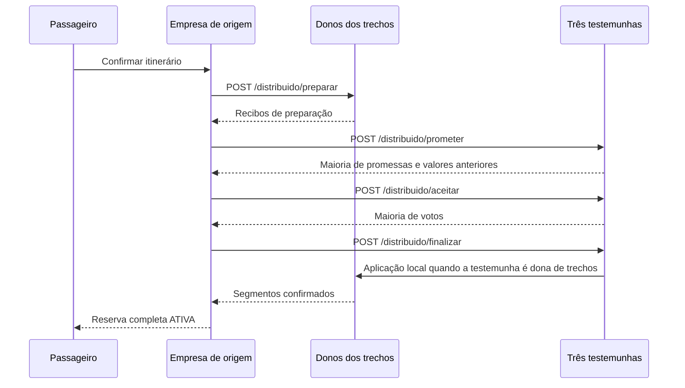

# Protocolo REST entre empresas

Especificação técnica da integração. Os comandos de execução e os backups estão descritos no README do Problema 2.

## Modelo de execução

Três processos, com identidades e endereços configurados localmente. Cada empresa
controla suas contas, caronas e assentos. O passageiro acessa somente sua própria
empresa por TCP; as empresas cooperam por HTTP/JSON. Não há banco, arquivo de
estado compartilhado, serviço externo de coordenação ou servidor central. Cada empresa salva seu próprio arquivo local de recuperação.

Os participantes compartilham somente metadados da transação: identificadores,
participantes, hashes dos pedidos, geração dos processos, promessas e decisões.
As ofertas remotas são cópias temporárias para consulta, não uma base replicada.

Uma empresa sem backup gera uma identificação aleatória ao iniciar. Transações incluem as
gerações que as testemunhas tinham quando a operação começou. Uma instância com
RAM nova sem backup não pode votar ou aplicar transações da geração perdida. Com o backup atual, a geração e as promessas são restauradas antes de abrir os atendimentos.

## Autenticação e transporte

Todas as chamadas exigem `Authorization: Bearer TOKEN`, configurado igualmente
nas três empresas por `VAIJUNTO_TOKEN_CONSORCIO` (mínimo de 16 caracteres).
As mensagens são JSON UTF-8. Os POSTs de coordenação têm limite de 1 MiB e
rejeitam campos desconhecidos, chaves duplicadas e valores adicionais.
Recibos e votos usam HMAC-SHA256 para validar certificados completos; isso não
é criptografia de transporte. O modelo é de falhas por interrupção, não de
empresas maliciosas que conhecem o token compartilhado.

## Recursos

| Método | Caminho | Finalidade |
|---|---|---|
| GET | `/saude` | Identidade e resposta básica da API de catálogo |
| GET | `/trechos` | Ofertas locais ativas com vagas e partida futura |
| GET | `/consorcio/trechos` | Consulta paralela e parcial aos catálogos |
| GET | `/distribuido/saude` | Identidade e geração do processo |
| POST | `/distribuido/preparar` | Preparar os assentos locais ou votar na possibilidade de cancelar |
| POST | `/distribuido/prometer` | Prometer uma cédula e informar o último valor aceito |
| POST | `/distribuido/aceitar` | Aceitar uma proposta compatível com a promessa |
| POST | `/distribuido/finalizar` | Verificar um certificado de maioria e aplicar a decisão |

O catálogo devolve `empresa_id` e `trechos`. Cada trecho tem `empresa_id`,
`trecho_id`, `carona_id`, origem, destino, partida, capacidade, vagas, preço,
distância e tempos. Não inclui e-mail do motorista nem lista de contas.
A agregação devolve `trechos` e `empresas_indisponiveis` com HTTP 200 mesmo se
uma parte das empresas estiver indisponível. Buscar não reserva vagas.

### Identidade do processo

Resposta de `/distribuido/saude`:

```json
{"empresa_id":"empresa-a","geracao":"identificador-aleatorio-do-processo"}
```

### Preparação

Envelope de `/distribuido/preparar` (valores de hashes são ilustrativos):

```json
{
  "meta": {
    "transacao_id": "identificador-global",
    "empresa_origem": "empresa-a",
    "inicio_itinerario": "2099-10-01T08:00:00-03:00",
    "tipo": "RESERVAR",
    "participantes": ["empresa-a", "empresa-b"],
    "hashes": {"empresa-a":"hash-pedido-a", "empresa-b":"hash-pedido-b"},
    "geracoes": {"empresa-a":"geracao-a", "empresa-b":"geracao-b", "empresa-c":"geracao-c"}
  },
  "pedido": {
    "transacao_id": "identificador-global",
    "empresa_origem": "empresa-a",
    "passageiro_ref": "referencia-opaca",
    "inicio_itinerario": "2099-10-01T08:00:00-03:00",
    "participantes": ["empresa-a", "empresa-b"],
    "trechos_ids": ["T000002"]
  }
}
```

O hash de cada empresa é SHA256 do JSON do `PedidoPreparacao` correspondente,
codificado pelo protocolo Go. A empresa receptora confere seu hash, identidade
da origem, participantes, início e geração. Antes de alterar vagas, valida todos
os seus trechos e escolhe assentos não ocupados nem preparados.
Somente após essa validação registra a preparação e devolve `{"recibo":"..."}`.
Repetir o mesmo pedido não separa outra vaga. Reutilizar o ID com dados diferentes
é recusado. Um pedido atrasado de uma transação já decidida não a reabre.

### Cédulas, promessas e aceitação

As cédulas são pares `(numero, empresa_id)`, comparados nessa ordem. `numero` é
um contador lógico local atualizado ao receber cédulas maiores. O identificador
da empresa desempata contadores iguais; não são usados relógios físicos para
ordenar as decisões.

`/prometer` recebe `meta` e `cedula`. Retorna:

- `promessa`: maior cédula prometida;
- `aceita`: cédula do último valor aceito (número zero indica ausência);
- `valor`: último valor aceito, quando existir;
- `final`: certificado já conhecido, quando existir.

`/aceitar` recebe `meta`, `cedula` e `valor`. Um valor tem `estado` (`CONFIRMAR`
ou `ABORTAR`), `motivo` opcional e mapa `recibos`. Confirmar exige os recibos de
todos os donos dos trechos. O receptor não aceita uma cédula menor que a promessa
nem dois valores diferentes na mesma cédula. A resposta inclui `voto` quando aceito.

O proponente coleta uma maioria de promessas e adota o valor aceito da maior
cédula nesse conjunto, caso exista. Depois solicita aceitação. Dois votos válidos
das três testemunhas formam um certificado. A implementação usa consenso de
valor único por transação; não delega essa função a bibliotecas ou serviços externos.

### Aplicação da decisão

`/finalizar` recebe `meta`, `cedula`, `valor` e `votos` (mapa empresa → assinatura).
Valida pelo menos dois votos distintos e a geração da própria instância.

- `CONFIRMAR`: move os assentos de preparados para ocupados, cria a reserva local
  e marca a transação confirmada; não desconta vagas novamente.
- `ABORTAR`: devolve uma preparação existente uma única vez. Mesmo sem preparação
  local, a decisão registrada impede uma preparação atrasada.

A resposta inclui `reserva` quando existe um segmento confirmado localmente.
Aplicações repetidas retornam o mesmo resultado. O passageiro só recebe estado
`ATIVA` depois de os donos de todos os trechos confirmarem a aplicação. Até lá,
o resultado global é `PENDENTE` e pode ser acompanhado em Minhas reservas.

## Sequência normal



## Concorrência, cancelamento e recuperação

O dono admite preparações sob suas travas locais. A primeira admitida que encontra
a vaga recebe o assento; o contador `ordem` registra essa admissão. Essa regra não
promete ordem de envio nem justiça global, pois mensagens podem sofrer atrasos.
As empresas e os trechos são adquiridos em ordem consistente; conflitos remotos
são recusados sem aguardar outros assentos. Isso evita ciclos de espera remotos.

Cancelamentos de reservas distribuídas são transações separadas, com tipo
`CANCELAR` e `transacao_original`. Cada dono verifica a reserva e o início do
itinerário inteiro. Uma decisão certificada aplica a devolução nos segmentos e
notifica a empresa de origem. Cancelar uma oferta primeiro cancela essas reservas;
uma preparação ou nova reserva concorrente impede invalidar a oferta por fora do protocolo.

Cada empresa executa recuperação periódica. Após um intervalo de suspeita, pode
propor aborto de uma transação interrompida. Se a fase de promessas encontrar um
valor já aceito, ele deve ser preservado; portanto, timeout não autoriza liberar
vagas unilateralmente. Decisões certificadas são retransmitidas de forma idempotente.
Uma operação inteiramente local usa o fluxo local e independe das testemunhas.

Limites explícitos:

- A recuperação funciona após uma pausa de comunicação ou após reinício com o backup atual da empresa.
- Com uma testemunha indisponível, as outras duas podem decidir.
- Sem maioria, transações distribuídas pendentes aguardam para preservar segurança;
  operações locais continuam disponíveis.
- O arquivo local inclui contas, ofertas, reservas, preparações e os registros de consenso dessa testemunha.
- A promessa e o voto só recebem resposta positiva após salvar o backup. Com o arquivo íntegro, a instância restaura sua geração e retoma as transações.
- Sem backup, uma instância tem geração nova e não vota em transações anteriores.

A perda do arquivo ou do disco e a restauração manual de cópias antigas estão fora dessa garantia. As sessões precisam de nova autenticação após o reinício.

## Códigos HTTP

| Código | Significado |
|---|---|
| 200 | Consulta ou operação concluída (uma promessa pode informar cédula superior) |
| 401 | Token ausente ou incorreto |
| 404 | Recurso de coordenação inexistente |
| 405 | Método incompatível |
| 409 | Pedido, estado, geração, metadados ou certificado incompatíveis |
| 413 | Mensagem acima do limite |

O chamador compara a promessa/cédula retornada; HTTP 200 não significa, sozinho,
que uma proposta recebeu um voto. Falhas de rede são tratadas como resultado
desconhecido e não como prova de que a operação não aconteceu.

## Executar e verificar

Use as três instâncias de `compose.consorcio.yaml`, com um token comum e um volume privado por empresa. Na execução em computadores distintos, configure `-pares` com
os endereços reais e libere as portas REST escolhidas nos firewalls.

Simulador a partir das três empresas:

```powershell
go run ./cmd/carga -servidores localhost:7001,localhost:7002,localhost:7003 -clientes 100 -vagas 5
```

O simulador cadastra passageiros em todas as empresas, publica três segmentos,
gera buscas e reservas concorrentes, mede latências e compara os assentos locais
com as transações globais. A checagem não exige consumir todas as vagas: tentativas
concorrentes podem ser abortadas com segurança.

### Portas livres durante a apresentação

Sem Docker, `go run ./cmd/servidor -endereco :0` pede ao sistema uma porta TCP
livre e a mantém reservada enquanto o servidor estiver executando. O terminal
mostra a porta efetiva. Conecte os clientes com `-servidor localhost:PORTA`.
`-rest :0` também funciona, mas os outros servidores precisam receber a URL
com a porta real em `-pares`; não existe descoberta automática de endereços.

No Docker, as portas internas 8080 e 8081 são isoladas por contêiner e podem
ser iguais. As portas publicadas no computador podem ser alteradas com
`VAIJUNTO_TCP_A`, `VAIJUNTO_TCP_B`, `VAIJUNTO_TCP_C`, `VAIJUNTO_REST_A`,
`VAIJUNTO_REST_B` e `VAIJUNTO_REST_C`. Use zero para publicação automática:

```powershell
$env:VAIJUNTO_TCP_A = $env:VAIJUNTO_TCP_B = $env:VAIJUNTO_TCP_C = "0"
$env:VAIJUNTO_REST_A = $env:VAIJUNTO_REST_B = $env:VAIJUNTO_REST_C = "0"
docker compose -p apresentacao-arthur -f compose.consorcio.yaml up --build -d
docker compose -p apresentacao-arthur -f compose.consorcio.yaml port empresa-a 8080
```

Configure o token antes de iniciar. O último comando mostra a porta publicada
para o cliente da empresa A; troque o serviço por `empresa-b` ou `empresa-c`
para as outras empresas. Para descobrir a porta REST, consulte 8081.
Os endereços internos entre as empresas permanecem os mesmos. Cada grupo que
execute Docker no mesmo computador deve usar um nome de projeto `-p` diferente.
Portas iguais em computadores diferentes não entram em conflito entre si.

```powershell
go test ./...
go vet ./...
```

Os testes de integração cobrem disputa entre três origens, repetição, cancelamento,
falha de comunicação antes e depois da escolha de uma decisão, retorno do mesmo
processo, ausência de maioria e recusa de votos de uma geração perdida.
